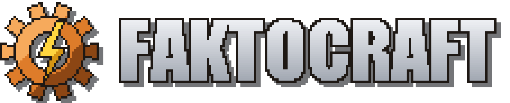
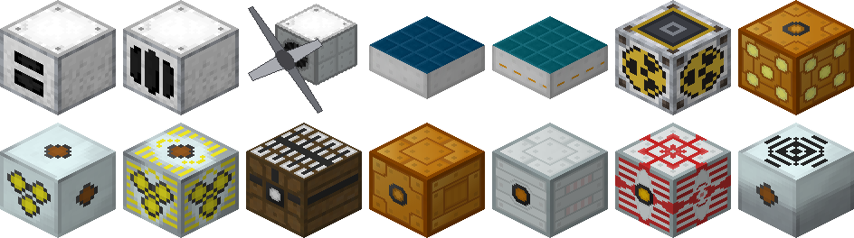
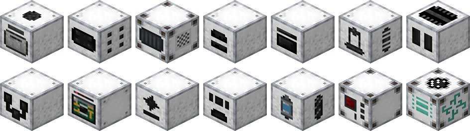
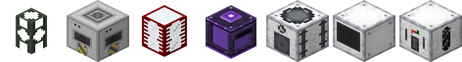
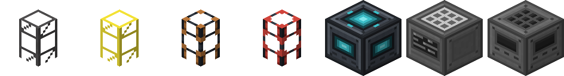
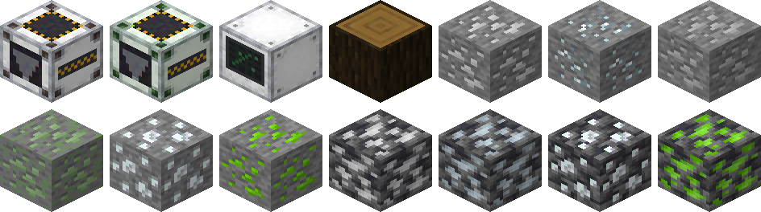
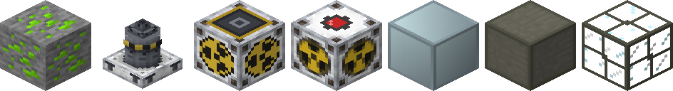

  

  <a href="https://www.curseforge.com/minecraft/mc-mods/faktocraft">Download</a> &nbsp;·&nbsp;
  <a href="https://pedrocmota.github.io/faktocraft">Wiki</a> &nbsp;·&nbsp;
  <a href="https://github.com/pedrocmota/faktocraft/issues">Report a bug</a>

Faktocraft is a modern successor of several classic tech mods - IndustrialCraft 2, BuildCraft and Logistics Pipes - rebuilt as a single, coherent mod: electrical machines, tiered power grids, item and fluid logistics, and automated mining.

This mod aims to be a spiritual successor that is extremely similar to the original; expect the same experience as in previous mods, but with a few specific changes.

## Power

Five voltage levels, ranging from "Low" to "Ultra," each with its own cables, transformers, circuit breakers, and battery boxes.

This mod features power generation from solid fuel, wind, solar, fossil fuels, geothermal, and nuclear sources.

## Machines

Ores go through the crusher first, which doubles the metal you get out of them. Washing and centrifuging the crushed ore gets a bit more out of it, plus some by-products. After that comes the usual set of machines: compressor, extruder, metal former, sawmill, alloy smelter, circuit assembler and canning machine. Late in the game, the recycler turns leftovers into scrap, the matter fabricator turns scrap into matter, and the replicator uses that matter to copy any item you scanned before.

## Oil and fluids

Oil spawns in three ways: small pockets underground, large reservoirs deeper down, and surface lakes in deserts and other dry biomes. You pump it, move it through fluid pipes and run it through the distillery to get fuel. The polymerizer turns it into plastic and rubber, the fluid enricher makes sulfuric acid and coolant, and the fermenter produces biofuel from biomass. Tanks hold it, valves control the flow, and the ender tank links its contents between any two places, including other dimensions.

<table>
  <tr>
    <td></td>
    <td></td>
  </tr>
</table>

## Logistics

Item pipes are see-through, so you can watch the items go by. Chassis pipes hold modules that decide what gets pulled from an inventory, where it goes, how it is sorted and what gets thrown away. The item filter works like the one in RimWorld. With a logistics core and a request table on the network, you can ask for an item and the system either fetches it from storage or crafts it, using craft pipes, recipe pipes and the assembly table, and spreading the work over whatever machines you have.

## Mining

<table>
  <tr>
    <td width="65%"></td>
    <td width="35%"></td>
  </tr>
</table>

Mark the area with landmarks, put the quarry next to one of them and it builds its own frame and digs the whole area down, one layer at a time. The forester uses the same kind of frame to plant, fertilize and harvest trees. Before you start, the prospector tells you what is under your feet, and the geological scanner maps entire regions and shares what it finds over scan channels. The mod adds seven ores, uranium among them, plus rubber trees. The hole drill carves channels through blocks so you can run cables and pipes inside walls.

## Nuclear

The reactor is a 3×3×3 multiblock with its own heat simulation. Fuel rods and neutron reflectors produce heat, water and coolant cells remove it, and if the heat gets out of control the reactor melts down. Uranium, a running reactor, a meltdown and the nuke all give off radiation. Lead and reinforced stone block it, the Geiger counter tells you how much you are getting, and the hazmat suit lets you work in a contaminated area.

## Everything else

There are jetpacks, nano and quantum armor, electric tools and night vision goggles. The status monitor is a wall panel that shows live information from any block. Teleport anchors move you between fixed points, and the dimensional one works across dimensions. The chunk loader keeps your base ticking while you are somewhere else. For building, there is the luminator, reinforced stone and reinforced glass.

## Compatibility

- **JEI** shows every recipe, and you can send a recipe straight to a machine, the request table or a pipe.
- **Jade** shows energy, voltage and machine status when you look at a block.
- **Sodium** and **Distant Horizons** work without any extra setup.
- Pipes, the quarry and the machines work with chests, tanks, buckets and hoppers from other mods, and with storage networks such as Applied Energistics 2 and Refined Storage. Ores and ingots follow the usual tags, so tin from Faktocraft and tin from another mod can be used in each other's recipes.
- Recipes can be changed with datapacks, KubeJS or CraftTweaker.

Some limits: the energy system is its own and does not convert to FE, so machines from Mekanism, Thermal or Create need their own power. The jetpack and the night vision goggles use the normal armor slots, not Curios. The quarry and the forester ignore land claims for now. Servers with region threading, like Folia, are not supported.

Faktocraft uses only the Forge and NeoForge APIs. There are no mixins to create incompatibilities with other mods.

## Wiki

The **[wiki](https://pedrocmota.github.io/faktocraft)** (English and Portuguese) has a page for every system and every important block, with recipes, numbers and step-by-step guides.

## Translations

The mod is written in English and tested in English and Portuguese. The other languages (Portuguese from Portugal, Spanish, Russian, Ukrainian, Slovak, Turkish, Japanese, Czech, Korean and Simplified Chinese) were machine translated and have not been checked by native speakers. If something reads wrong, corrections are welcome.

## Bug reports

If you find a bug, open an issue on the [issue tracker](https://github.com/pedrocmota/faktocraft/issues).

## License

[MIT](LICENSE)
